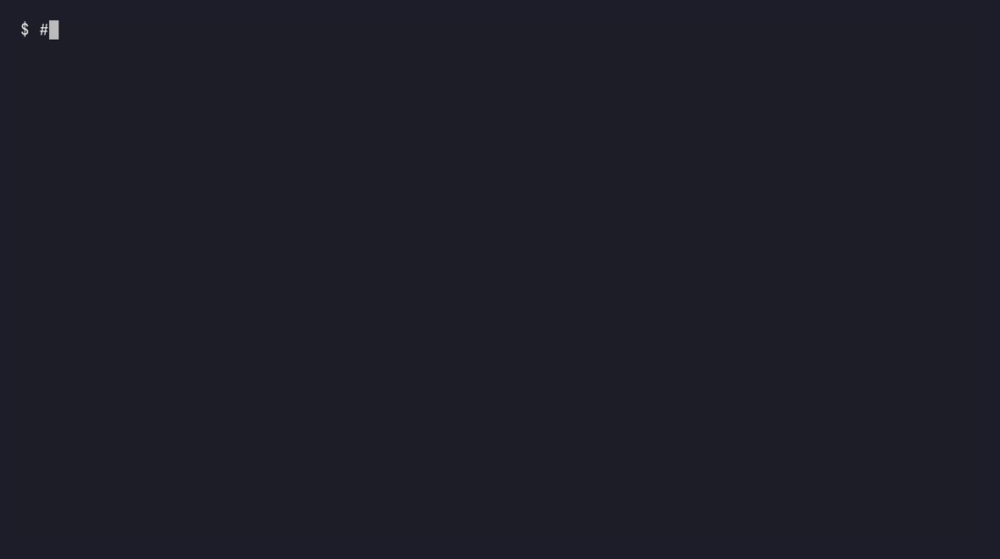

# Align CLI

[](https://www.npmjs.com/package/@aligndottech/cli)
[](https://github.com/aligndottech/align-cli/actions/workflows/ci.yml)
[](./LICENSE)
[](https://nodejs.org)

**Your AI agents know the code. They don't know the company.**

Align reads the decisions your team already made, from commits, pull requests, docs, tickets and
chat. Then it checks your coding agent's changes against them. Nobody writes the decisions in by
hand: Align reads them from where they were made, and reads again when you run it.

See it catch a decision in a few seconds, with nothing installed and no account or AI key:

```bash
npx @aligndottech/cli demo
```

It runs in a temp folder and leaves your repo and `~/.align` alone. The first run downloads a
small on-device model (about 50 MB) once.



*The same prompt, two real runs on Align's own repo (14 Oct 2026). The text is
copied from those runs and shortened. The GIF replays it, so it isn't a live session ([how](docs/demo/demo.tape)).
Without Align the agent plans to skip signature checks; with it, the agent stops and cites the
decision that ruled that out.*

## Use it on your own repo

```bash
npm install -g @aligndottech/cli
align
```

Needs Node 22.19 or newer. On an older Node, npm installs an old release of this package that lacks `align up`, so check `node -v` first. Local mode also needs a glibc-based Linux, so on Docker use `node:22-bookworm-slim`, not an Alpine image.

No Node? `curl -fsSL https://align.tech/install.sh | sh` installs a standalone binary instead.
Windows and the details are in [Installing](docs/installation.md).

Run `align` in a git repo. It reads your commits, ADRs and RFCs, decision logs, `CLAUDE.md`,
`AGENTS.md` and recent merged pull requests, and stores what was decided, why and where in a local
file, `~/.align/local.db`. This README calls that the graph. Then it asks how you want to use it.
Before it writes anything it lists every file and asks.

MIT, no account needed. Beta, pre-1.0.

## Three ways to use it

Use one, or all three.

### 1. A decisions file you commit

Nothing is wired into your agent. One command writes the file, and your agent reads it like any
other file in the repo. It needs no setup first.

```bash
align up --out DECISIONS.md --limit 30
```

This reads the repo's commits, pull requests and docs, writes `DECISIONS.md`, and adds
`@DECISIONS.md` to your `CLAUDE.md`. With no `CLAUDE.md`, it prints that line for you to add.
Commit both. Run it again whenever you want a new version.
The file lists the rules written in your docs first, then the commits that state a decision, with
the reason where one was given. Fixes and chores are left out.

Two protections. It never replaces a file it did not write, and it will not write into
`CLAUDE.md` or `AGENTS.md`. And `--out` only writes when every decision comes from this repo's
own commits, pull requests and committed docs, on your local graph. If any decision comes from a
chat, a ticket, another repo or a doc you have not committed, `--out` refuses. Plain `align up`
then writes a private `.align/decisions.md` that stays out of git.

### 2. A check inside your agent

`align` wires two things into your agent. An edit hook checks each edit against the graph. An MCP
server (the standard way an agent calls an outside tool) lets the agent ask the graph a question.
The hook runs outside the model, so the agent doesn't have to remember to ask. It shows the
decision behind the code and where it came from.

- **Claude Code:** the check runs before the edit is written. That is recorded in headless runs
  only; interactive sessions are not tested.
- **Cursor, Copilot CLI and Gemini CLI:** their hooks hand the result to the model after the edit
  lands. None of the three has been tested against a live session.
- It warns by default, and blocking is opt-in. If Align is slow or errors, the edit goes ahead.

[Hook coverage](docs/hook-coverage.md) lists what has and has not been tested, host by host.
[Agent hooks](docs/agent-hooks.md) has what each agent can and can't do, what setup writes, and
[how the pieces fit](docs/agent-hooks.md#how-it-works).
To undo everything Align wrote, run `align use --undo`.

Claude Code users can install it as a plugin instead:

```
/plugin marketplace add aligndottech/align-cli
/plugin install align-cli@aligndottech
```

Then run `npx @aligndottech/cli` once in the repo to build the graph. Codex has a plugin too. Its
hook does nothing until you approve it once inside Codex. After that we have seen it run in
`codex exec` (Codex CLI 0.153.0), though no recorded payload backs that yet. Both are in
[Installing](docs/installation.md#claude-code-plugin).

### 3. A check in CI

Fail a pull request that goes against a decision in your committed file:

```bash
align check --ci --base origin/main --decisions-file DECISIONS.md
```

It needs only your own provider key, for example `OPENAI_API_KEY` from a repository secret. No
account, no graph, no MCP. It exits `1` on a conflict and `2` when it could not check, so a
check that did not run never passes. A diff too big for the model to read whole is a `2` as
well. The workflow file is in [Alignment check](docs/check.md#in-ci-with-a-decisions-file-no-account).

### ADRs in your repo

`align adr` lists the decisions that never got an ADR. `align adr write` goes through them and
drafts one for each you accept, in your existing ADR folder, numbered after the last one. The
text comes from the commit or pull request itself, with a link back to it. No model writes it,
and no file is ever replaced.

## What it reads

Git history, the repo's ADRs and RFCs, decision logs, `CLAUDE.md`, `AGENTS.md`, tenets and
architecture docs. With `align connect`: GitHub, GitLab, Jira, Confluence, Linear, Notion, Slack,
Teams and Zoom. Also [nightshift](https://github.com/orwa-mahmoud/nightshift)'s parking lot and
plan record (`align connect nightshift`), MIRSAD exports, and the ADR replacements
[ADR Guard](https://github.com/rodri-oliveira-dev/adr-guard) validated (`align connect adr-guard`). All read-only.
[Importing](docs/importing.md) has every source and its flags.

Connected sources refresh in the background when you start `align`, at most every 15 minutes per
source. There is no timer, so nothing refreshes while you only have your agent open.

## Privacy and telemetry

Align is open source ([MIT](./LICENSE)). In local mode the graph is a SQLite file on your machine,
`~/.align/local.db`. Tokens you paste for a connector go in your OS credential store (Keychain,
Secret Service or DPAPI), or in `config.json` if there is none. In local-only mode the only thing
sent to Align is anonymous usage counts, never code or decision text, unless you run `align share`.
It tells you once before the first one and sends nothing from CI. Turn them off with
`align telemetry off` or `DO_NOT_TRACK=1`.

Two things do leave your machine. The first run in a github.com repo reads that repo's recent
merged pull requests from api.github.com without asking. And `align ask` and `align check` send
your question or your diff, with the matching decisions, to the AI provider whose key you set, or
to your local model. They do not go to Align. npm releases are published with provenance.

[What touches the network](docs/local-mode.md) and [every field we send](docs/telemetry.md).

## Everyday commands

```bash
align                                # set up, or see your graph and what to do next
align ask "how does our auth work"   # an answer, with sources
align ask src/auth/session.ts        # decisions about a file
align connect                        # pick a source to import: git, docs, jira, github, ...
align connect jira --token ...       # import one source directly
align check                          # check your staged diff against the graph
align mcp --setup                    # wire your agent to the graph
```

`align --help` lists the main ones, and the rest are in [docs/commands.md](docs/commands.md). Something not working? `align doctor`
checks the install, the graph and one real question, and names the next step for each failure.

`align ask` and `align check` need an AI key or a local Ollama to write an answer or a verdict.
So does telling a replaced decision from a conflicting one on a local graph. Inside your agent,
search needs no key, because the agent does the reading.
[Setting one up](docs/configuration.md#ai-provider).

## Teams

Team graphs are by invitation: your admin sends a link, and you run `align join`. Already have a
team graph? Run `align login`, then `align`. Starting a new one is by call for now. A personal
email doesn't get a cloud graph, so solo use is the local graph.
[Joining your team](docs/join-your-team.md).

## Does it work

One published study gave a coding agent the product decisions on record and saw decision
compliance go from 46% to 95%
([Dillon & Varanasi, arXiv:2605.08112](https://arxiv.org/abs/2605.08112)). It's a small vendor
study, 8 tasks and 41 decision points, and it isn't our data.

Our own benchmark is on our own repos: 29 decisions, every answer labelled by a person. With
Align the agent followed the current decision in 139 of 145 runs, with read-only repo search 96
of 145, and with no tools 34 of 145. Where the decision was never written in the code, it was 29
of 30 against 5 of 30. It's dogfood, not customer data, and the product was tuned on these
tasks. [Method and raw results](https://align.tech/benchmark).

From people using it:

> Align caught a gap in my own pull request to Align. It flagged that my change went against a
> decision the team had already recorded, and it was right. With pi, the finding reaches the
> model before the edit lands, which is exactly where you want it.
>
> Ryan Joshua Gapac ([#569](https://github.com/aligndottech/align-cli/pull/569))

With pi, a finding that blocks stops the edit before it runs. One that doesn't is added to
the edit's result, so the model reads it straight after.

> The pipe-guard question found the right commit and its reason: that guard would have refused
> about 1 in 24 of the Bash calls I'd recorded. Handy to get that back.
>
> Collin Nerdahl, maker of [Andon](https://github.com/PrimeFoldTools/Andon)

Want a hand setting it up? I do free 30-minute calls: https://calendly.com/tom-align/setup

## Docs

| | |
|---|---|
| [Installing](docs/installation.md) | npm, the binary, Windows, the Claude Code and Codex plugins |
| [Your first session](docs/first-session.md) | Three prompts, which agent runs, and how to tell the check is running |
| [Importing](docs/importing.md) | Every source, tokens, flags |
| [Alignment check](docs/check.md) | Modes, exit codes, CI, the GitHub Action |
| [Agent hooks](docs/agent-hooks.md) | How it works, what setup writes, and what each host can and can't do |
| [Hook coverage](docs/hook-coverage.md) | What has been tested, host by host |
| [Cloud or local-only](docs/local-mode.md) | What runs where, what touches the network |
| [Telemetry](docs/telemetry.md) | Every event and field, and how to turn it off |
| [MCP server](docs/mcp.md) | Editor config, the tools your agent gets |
| [Configuration](docs/configuration.md) | AI providers, env vars, auth, self-hosting |
| [Join your team's graph](docs/join-your-team.md) | `align join`, hosted and self-hosted |
| [Choosing an access path](docs/access-capability.md) | API, CLI JSON or MCP, and why |
| [All commands](docs/commands.md) | Full reference |

## License

MIT, see [LICENSE](./LICENSE). The CLI, the MCP server and the
[connector SDK](https://github.com/aligndottech/align-connector-sdk) are open source. The hosted
team product is a separate commercial service.
