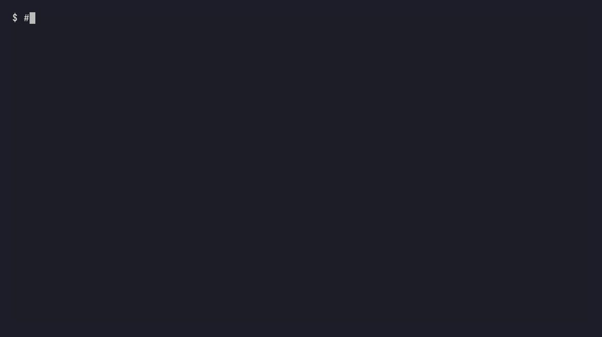

# Align CLI

[](https://www.npmjs.com/package/@aligndottech/cli)
[](https://github.com/aligndottech/align-cli/actions/workflows/ci.yml)
[](./LICENSE)
[](https://nodejs.org)

**Your AI agents know the code. They don't know the company.**

Align collects your team's decisions from commits, tickets, chat and meetings into one graph.
Your coding agent can look up the decisions behind the code, and where each one came from,
before it changes it.

```bash
npm install -g @aligndottech/cli
align
```

No Node? `curl -fsSL https://align.tech/install.sh | sh` installs a standalone binary instead.



*The same prompt, two real runs on Align's own repo (14 Oct 2026). The text is
copied from those runs and shortened. The GIF replays it, so it isn't a live session ([how](docs/demo/demo.tape)).
Without Align the agent plans to skip signature checks; with it, the agent stops and cites the
decision that ruled that out.*

Run it in a git repo. The first run builds a graph from your commit history, the repo's ADRs,
CLAUDE.md and AGENTS.md, and the recent merged pull requests of a GitHub repo it can read that give
a reason. After that, `align`
opens Align's own coding agent over that graph, and refreshes connected sources in the
background, at most every 15 minutes per source (`align sync --off` turns that off).

You choose what runs behind it:

- **Your own API key** (Anthropic, OpenAI, Gemini and others, set with `align ai`), or a local
  model through Ollama.
- **Your own Claude Code.** Anthropic does not let other apps use a Claude subscription, so with
  no key Align drives your installed Claude Code and you stay on your plan. Align never sees your
  Claude login.

`align --engine align` or `align --engine claude` picks one, and Align remembers it. Every edit is
checked against the graph before it is written. An edit that rewrites lines a decision wrote
waits for you to allow it or stop it.

Prefer your agent's own interface? `align -- <args>` still opens it with the graph connected.

MIT, no account needed. Beta, pre-1.0.

## Try it on a repo you didn't write

Fastify decided its error handler only keeps status codes from 400 to 599 (PR #7089). Nothing
in the code says why. Ask your agent to undo it and see what happens:

```bash
git clone https://github.com/fastify/fastify && cd fastify
align                     # builds the graph from git history, then opens Align
```

Then, in Align:

```text
Errors with a 1xx-3xx statusCode currently fall back to 500.
Change lib/error-status.js so they keep their status code.
```

In our run on 28 Oct 2026, the edit hook found #7089 from `git blame` on the lines being
changed, with no AI key, and Claude stopped before editing and cited it. On 4 Nov 2026, on
0.66.1, Claude asked Align over MCP before it tried an edit, so the hook never fired. It cited
#7089 and #601 (2018: "do not allow set status code to lower than 400"), changed nothing, and
asked what to do. Models are not deterministic, so your run may word it differently.

On 6 Nov 2026 we ran the same prompt in Align's own agent, once on Claude Code and once on an
OpenAI key. Both times the agent tried the edit, Align found #7089 from `git blame` and asked
first, and after "stop" the agent cited #7089 and changed nothing.

## Install

- **npm:** `npm install -g @aligndottech/cli` (Node 22.19+).
- **macOS / Linux, no Node:** `curl -fsSL https://align.tech/install.sh | sh` installs a
  standalone binary and checks it against the release checksums. Read [install.sh](install.sh)
  first if you like.
- **Windows:** npm in PowerShell. The `curl` line needs a POSIX shell (Git Bash or WSL). Without
  Node, download `align-windows-x64.exe` (or `-arm64`) from the
  [releases page](https://github.com/aligndottech/align-cli/releases/latest), rename it to
  `align.exe` and put it on your `PATH`.

More in [docs/installation.md](docs/installation.md).

## How it works

1. **Import.** Reads decisions from Git (commits that state a reason), the repo's ADRs, CLAUDE.md
   and AGENTS.md, GitHub, GitLab, Jira, Confluence, Linear, Notion, Slack, Teams and Zoom.
   Read-only. In a repo, GitHub and GitLab (gitlab.com) read that repo, as far as your token can see. For Jira, Linear, Confluence and Notion you
   pick what belongs to it (a Jira project, board or filter, Linear projects, Confluence page trees,
   Notion pages) or skip the source there. Each repo keeps its own choice ([Importing](docs/importing.md#whose-items-yours-or-your-teams)).
2. **Link.** Records what was decided, why and by whom. Related decisions surface as related. Telling replaced from conflicting needs an AI key locally, or a team graph.
3. **Check.** Your agent queries the graph over MCP, an edit hook, CI or `align ask`.

`align` wires it in four ways, so the check runs whether or not the model thinks to ask:

| | |
|---|---|
| **MCP server** | Claude Code, Cursor, Claude Desktop, VS Code, Windsurf, Zed, Codex, Copilot CLI, Gemini CLI, pi, OpenCode |
| **Edit hooks** | Each edit is checked against the graph. Advisory by default. Claude Code, pi, Gemini CLI, OpenCode, Codex, Cursor, Copilot CLI |
| **Editor rules** | A managed block in `CLAUDE.md`, `AGENTS.md` and `.cursor/rules/align.md` |
| **Shared `.mcp.json`** | One committed file sets up the whole team |

Before writing anything, setup lists every file it will create or change, with files outside your
project (an agent's own config, user-level hooks) under their own heading, and asks. With no
terminal to ask in (an agent's shell, CI) it writes nothing unless you pass `--approve`.

To undo everything align wrote, run `align use --undo`.

The hook never blocks on a model's judgement unless you turn blocking on, and that needs an AI
key. One thing can deny without it, on a team graph: a rule your team ratified (secrets, card numbers,
emails), when the edit contains one. If Align is slow, errors or times out, the edit goes ahead. If you uninstall `align`, rerun
`align mcp --setup`: an older Copilot CLI hook file can deny edits until it is rewritten.

Hook limits worth knowing:

- Cursor, Copilot CLI and Gemini CLI only hand the result to the model after the edit lands.
  That's a limit of their hook APIs.
- Only Claude Code's hook has been run in a live session. pi, Gemini CLI and OpenCode are written
  from the vendors' docs or source, and Codex, Cursor and Copilot CLI have not been checked
  against a real payload. The last three read hooks from a user-level file (`~/.codex/hooks.json`,
  `~/.cursor/hooks.json`, `~/.copilot/hooks/align.json`).
- pi's MCP entry needs the third-party `pi-mcp-adapter` package installed in pi. pi also blocks a
  repo's MCP servers until you trust the project, and Align's entry counts as one, so accept pi's
  trust prompt or Align's tools won't load. `pi -p` skips the prompt and runs without them.
- Claude Code asks you to approve a committed hook the first time. Accept, or it won't run.

[Per-host details](docs/agent-hooks.md).

## Your first five minutes

Setup ends with three prompts to type into your agent, built from your own repo:

```text
1. why did we switch to postgres?                     learn why the code is the way it is
2. what was decided about src/db/pool.ts?             before you touch a file
3. Plan a change that reverses "switch to postgres".  watch the agent stop and cite the decision
   Check it with Align before writing anything.
```

After that the check runs on its own on every edit, and the agent tells you in one line when it
found a related decision. [Your first session](docs/first-session.md) has more, including how to
tell whether the hooks are running.

## Everyday commands

```bash
align                                # set up, or see your graph and what to do next
align ask "how does our auth work"   # an answer, with sources
align ask src/auth/session.ts        # decisions about a file
align connect                        # pick a source to import: git, docs, jira, github, ...
align connect jira --token ...       # import one source directly
align check                          # check your staged diff against the graph
align mcp --setup                    # wire your agent to the graph
```

`align --help` lists `ask`, `connect`, `check`, `share` (alias `push`), `mcp` and `agents`. The
rest (`search`, `decisions`, `stale`, `export`, `ratify`, `context`, ...) still work and are in
[docs/commands.md](docs/commands.md).

Something not working? `align doctor` checks Node, that `align` is on your PATH, that the gateway
answers, that your token is accepted, and that one real question comes back through `align mcp`.
It names the next step for each failure and exits non-zero if any check fails. It sends no
telemetry.

Inside your agent, the agent writes the answers, so you don't need an AI key. Only `align ask`
in a terminal writes its own. Give it a key (Anthropic, OpenAI, OpenRouter, Gemini, Groq,
Mistral or xAI), a local Ollama, or any OpenAI-compatible endpoint. Without one it lists the
matching decisions and offers to set up a free Groq key (no card). With several, `align ai`
picks one. [Setting one up](docs/configuration.md#ai-provider).

## Privacy and telemetry

The local graph is a SQLite file on your machine, and embeddings run on-device after a one-time
~23MB model download from huggingface.co. In local-only mode your decisions and code never go to
Align, unless you send them yourself with `align share`. The first run in a github.com repo reads
that repo's recent merged pull requests from api.github.com without asking, and tools you connect
are read with your own tokens. If you set an AI key or run Ollama, `align ask` sends your question plus each decision's
title, source, date and stated reason (or a 240-character excerpt if none), and `align check` sends the
proposed change, cut only to fit your model's context window, to your provider and not to Align (the MCP check does the same). Ollama counts as yours, wherever
`OLLAMA_HOST` points. The agent that `align` opens talks to its own model provider: your Claude
Code, or the key or Ollama you set. Team graphs are hosted by Align, or self-hosted,
so the team can share them.

Local-only mode sends anonymous usage counts. It tells you once before the first one and sends
nothing from CI. Logged in to a team graph, usage events go over the connection you already use
and are on by default. Either way, `align telemetry off` stops them.
[What touches the network](docs/local-mode.md) and [every field we send](docs/telemetry.md).

## Teams

Team graphs are by invitation: your admin sends a link, and you run `align join` ([docs](docs/join-your-team.md)). Already
have a team graph? Run `align login`, then `align`. Setup connects your tools with read-only OAuth
and wires up your editors. Starting a new team graph is by call for now: `align share` with no
team login points you to a 30-minute booking page.

A personal email doesn't get a cloud graph, so solo use is the local graph. Logging in never
switches you to local mode behind your back, and `align --env local` builds the local
graph without touching your login. [Joining your team](docs/join-your-team.md).

## Docs

| | |
|---|---|
| [Installing](docs/installation.md) | npm, the binary, Windows |
| [Your first session](docs/first-session.md) | Three prompts, and how to tell the check is running |
| [Join your team's graph](docs/join-your-team.md) | `align join`, hosted and self-hosted |
| [Importing](docs/importing.md) | Every source, tokens, flags |
| [Alignment check](docs/check.md) | Modes, exit codes, CI, the GitHub Action |
| [Cloud or local-only](docs/local-mode.md) | What runs where, what touches the network |
| [Telemetry](docs/telemetry.md) | Every event and field, and how to turn it off |
| [MCP server](docs/mcp.md) | Editor config, the tools your agent gets |
| [Configuration](docs/configuration.md) | AI providers, env vars, auth, self-hosting |
| [Agent hooks](docs/agent-hooks.md) | What each host can and can't do |
| [Choosing an access path](docs/access-capability.md) | API, CLI JSON or MCP, and why |
| [All commands](docs/commands.md) | Full reference |

## Why bother

One published study gave a coding agent the product decisions on record and saw decision
compliance go from 46% to 95%
([Dillon & Varanasi, arXiv:2605.08112](https://arxiv.org/abs/2605.08112)). It's a small vendor
study, 8 tasks and 41 decision points, and it isn't our data.

Our own benchmark is on our own repos: 29 decisions, every answer labelled by a person. With
Align the agent followed the current decision in 139 of 145 runs, with read-only repo search 96
of 145, and with no tools 34 of 145. Where the decision was never written in the code, it was 29
of 30 against 5 of 30. It's dogfood, not customer data, and the product was tuned on these
tasks. [Method and raw results](https://align.tech/benchmark).

Wiring context into an agent is the easy part, and that's what this repo is. The hard part is
keeping an accurate record of what your team actually decided, across every tool.

Want a hand setting it up? I do free 30-minute calls: https://calendly.com/tom-align/setup

## License

MIT, see [LICENSE](./LICENSE). The CLI, the MCP server and the
[connector SDK](https://github.com/aligndottech/align-connector-sdk) are open source. The hosted
team product is a separate commercial service.
