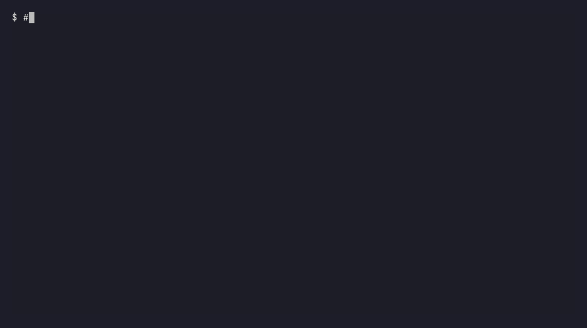

# Align CLI

[](https://www.npmjs.com/package/@aligndottech/cli)
[](https://github.com/aligndottech/align-cli/actions/workflows/ci.yml)
[](./LICENSE)
[](https://nodejs.org)

**Your AI agents know the code. They don't know the company.**

Align pulls your team's decisions out of commits, tickets, chat and meetings into one graph.
Your coding agent checks that graph before it edits code.

```bash
npm install -g @aligndottech/cli
align
```

No Node? `curl -fsSL https://align.tech/install.sh | sh` installs a standalone binary instead.



*The same prompt, two real runs on Align's own repo, replayed from their transcripts
([how](docs/demo/demo.tape)). Without Align the agent plans to skip signature checks; with
it, the agent stops and cites the decision that ruled that out.*

Run it in a git repo. The first run asks which agent you use, builds a graph from your commit
history and wires the agent up. After that, `align` opens your agent with the graph connected
and refreshes connected sources in the background, at most every 15 minutes per source
(`align sync --off` turns that off).

MIT, no account needed. Beta, pre-1.0.

## Install

- **npm:** `npm install -g @aligndottech/cli` (Node 22.16+).
- **macOS / Linux, no Node:** `curl -fsSL https://align.tech/install.sh | sh` installs a
  standalone binary and checks it against the release checksums. Read [install.sh](install.sh)
  first if you like.
- **Windows:** npm in PowerShell. The `curl` line needs a POSIX shell (Git Bash or WSL). Without
  Node, download `align-windows-x64.exe` (or `-arm64`) from the
  [releases page](https://github.com/aligndottech/align-cli/releases/latest), rename it to
  `align.exe` and put it on your `PATH`.

More in [docs/installation.md](docs/installation.md).

## How it works

1. **Import.** Reads decisions from Git, GitHub, GitLab, Jira, Confluence, Linear, Notion, Slack,
   Teams and Zoom. Read-only.
2. **Link.** Records what was decided, why, by whom, what replaced what, and what conflicts.
3. **Check.** Your agent queries the graph over MCP, an edit hook, CI or `align ask`.

`align` wires it in four ways, so the check runs whether or not the model thinks to ask:

| | |
|---|---|
| **MCP server** | Claude Code, Cursor, Claude Desktop, VS Code, Windsurf, Zed, Codex, Copilot CLI, Gemini CLI, pi, OpenCode |
| **Edit hooks** | Each edit is checked as it happens. Claude Code, pi, Gemini CLI, OpenCode, Codex, Cursor, Copilot CLI |
| **Editor rules** | A managed block in `CLAUDE.md`, `AGENTS.md` and `.cursor/rules/align.md` |
| **Shared `.mcp.json`** | One committed file sets up the whole team |

The hook never blocks an edit unless you turn blocking on, and blocking needs an AI key. If Align
is missing, slow or down, the edit goes ahead.

Hook limits worth knowing:

- Cursor, Copilot CLI and Gemini CLI only hand the result to the model after the edit lands.
  That's a limit of their hook APIs.
- Codex, Cursor and Copilot CLI read hooks from a user-level file (`~/.codex/hooks.json`,
  `~/.cursor/hooks.json`, `~/.copilot/hooks/align.json`). None of the three has been checked
  against a real session's payload yet.
- Claude Code asks you to approve a committed hook the first time. Accept, or it won't run.

[Per-host details](docs/agent-hooks.md).

## Everyday commands

```bash
align                                # set up, or see your graph and what to do next
align ask "how does our auth work"   # an answer, with sources
align ask src/auth/session.ts        # decisions about a file
align connect                        # pick a source to import: git, docs, jira, github, ...
align connect jira --token ...       # import one source directly
align check                          # check your staged diff against the graph
align mcp --setup                    # wire your agent to the graph
```

That's all of `align --help`. The rest (`search`, `decisions`, `export`, `ratify`, `push`,
`context`, `local`, ...) still work and are in [docs/commands.md](docs/commands.md).

Inside your agent, the agent writes the answers, so you don't need an AI key. Only `align ask`
in a terminal writes its own. Give it a key (Anthropic, OpenAI, OpenRouter, Gemini, Groq,
Mistral or xAI), a local Ollama, or any OpenAI-compatible endpoint. Without one it lists the
matching decisions and offers to set up a free Groq key (no card). With several, `align ai`
picks one. [Setting one up](docs/configuration.md#ai-provider).

## Privacy and telemetry

The local graph is a SQLite file on your machine, and embeddings run on-device. In local-only
mode your decisions and code never go to Align. Team graphs are hosted by Align, or self-hosted,
so the team can share them.

Local-only mode sends anonymous usage counts. It tells you once before the first one and sends
nothing from CI. Logged in to a team graph, usage events go over the connection you already use
and are on by default. Either way, `align telemetry off` stops them.
[What touches the network](docs/local-mode.md) and [every field we send](docs/telemetry.md).

## Teams

Run `align login`, then `align`. A work email puts you in your company's graph: the first
person in is the admin, and colleagues on the same domain join automatically. Setup connects your
tools with read-only OAuth and wires up your editors.

A personal email doesn't get a cloud graph, so solo use is the local graph. Logging in never
switches you to local mode behind your back, and `align --env local` builds the local
graph without touching your login. [Joining your team](docs/join-your-team.md).

## Docs

| | |
|---|---|
| [Installing](docs/installation.md) | npm, the binary, Windows |
| [Join your team's graph](docs/join-your-team.md) | `align join`, hosted and self-hosted |
| [Importing](docs/importing.md) | Every source, tokens, flags |
| [Alignment check](docs/check.md) | Modes, exit codes, CI, the GitHub Action |
| [Cloud or local-only](docs/local-mode.md) | What runs where, what touches the network |
| [Telemetry](docs/telemetry.md) | Every event and field, and how to turn it off |
| [MCP server](docs/mcp.md) | Editor config, the tools your agent gets |
| [Configuration](docs/configuration.md) | AI providers, env vars, auth, self-hosting |
| [Agent hooks](docs/agent-hooks.md) | What each host can and can't do |
| [Choosing an access path](docs/access-capability.md) | API, CLI JSON or MCP, and why |
| [All commands](docs/commands.md) | Full reference |

## Why bother

One published study gave a coding agent the product decisions on record and saw decision
compliance go from 46% to 95%
([Dillon & Varanasi, arXiv:2605.08112](https://arxiv.org/abs/2605.08112)). It's a small vendor
study, 8 tasks and 41 decision points, and it isn't our data.

Wiring context into an agent is the easy part, and that's what this repo is. The hard part is
keeping an accurate record of what your team actually decided, across every tool.

Want a hand setting it up? I do free 30-minute calls: https://calendly.com/tom-align/setup

## License

MIT, see [LICENSE](./LICENSE). The CLI, the MCP server and the
[connector SDK](https://github.com/aligndottech/align-connector-sdk) are open source. The hosted
team product is a separate commercial service.
